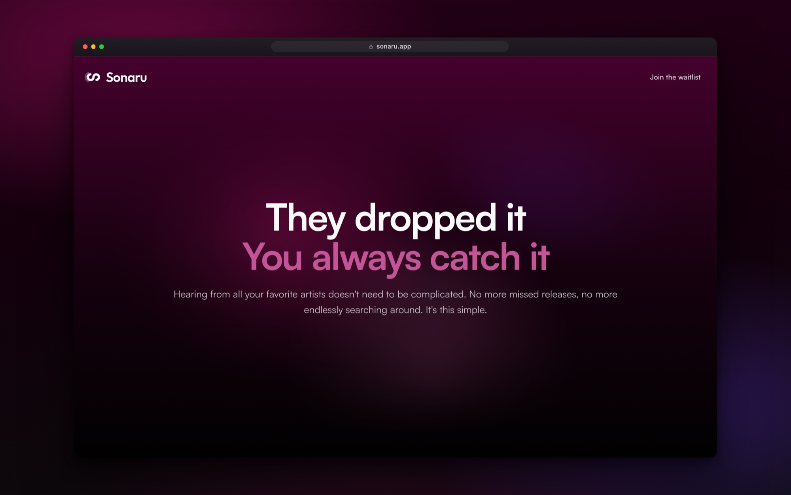
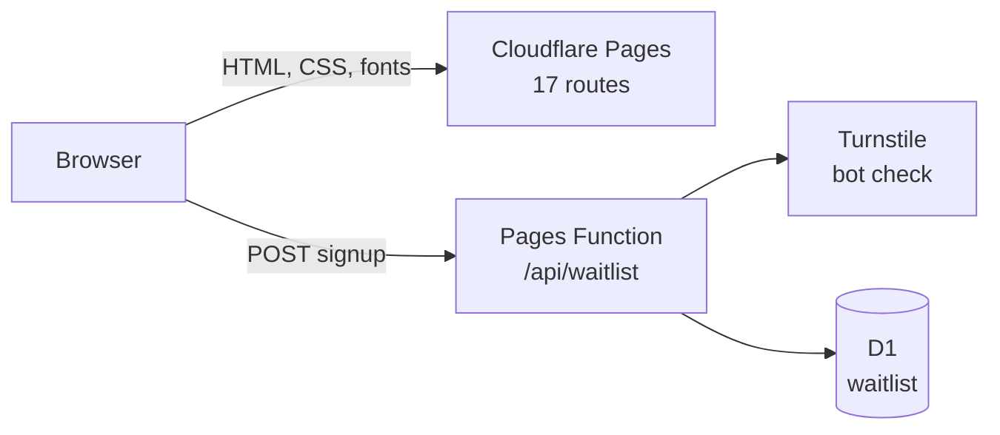

# sonaru-lander

The marketing site for Sonaru, a mobile app that notifies you when your favorite artists release new songs, in order, without an algorithm deciding what you see. [sonaru.app](https://sonaru.app)



| Folder                            | Stack                                                              |
| --------------------------------- | ------------------------------------------------------------------ |
| [`src/`](src)                     | Astro with TypeScript, Tailwind, GSAP + Lenis                      |
| [`functions/api/`](functions/api) | Cloudflare Pages Function for the waitlist, Turnstile, D1 (SQLite) |
| [`tests/`](tests)                 | Playwright. Unit, e2e and visual (672 tests, 172 visual baselines) |

## Architecture



**Performance and accessibility:** the LCP headline doesn't animate/wait on a font, every colour pairing is scored for contrast, and every route has zero WCAG 2.2 AA violations at three widths in both motion modes.

```
src/
  pages/[...locale]/  every route, emitted once per published locale
  components/         sections/ (one per act of the home page), device/ (the phone as real DOM), primitives/
  motion/             tokens, plugin registry, timeline factories
  content/            blog, changelog, legal, showcase artwork manifest
  styles/tokens.css   color definitions, etc
copy/                 one folder per language, one file per surface
scripts/              og images, press kit, brand PDF, fonts, contrast
```

## Running locally

Requires Node 22 or newer.

```bash
npm install
npm run dev       # http://localhost:4321 (runs as a daemon; npm run stop ends it)
npm run verify    # typecheck, lint, format, contrast, build, HTML validation and all 672 tests
```

The waitlist works locally with no Cloudflare account. A dev only Vite plugin runs the production rules with an in memory store and Turnstile's test keys. Design decisions are recorded in [`docs/`](docs).

## Licences

Typeface licences are in [`public/fonts/LICENSES.md`](public/fonts/LICENSES.md). Album artwork and artist photography belong to their rights holders; the takedown contact and removal procedure are in [`src/content/showcase/README.md`](src/content/showcase/README.md) and [ADR 0009](docs/adr-0009-artwork-risk.md).
